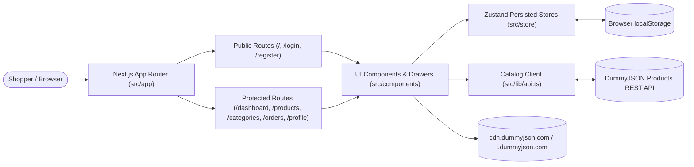
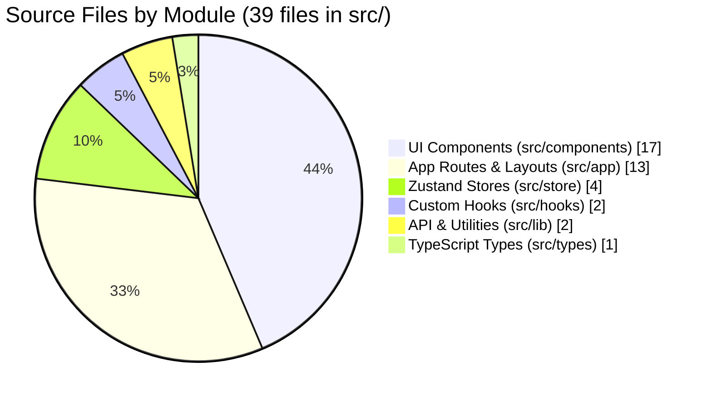
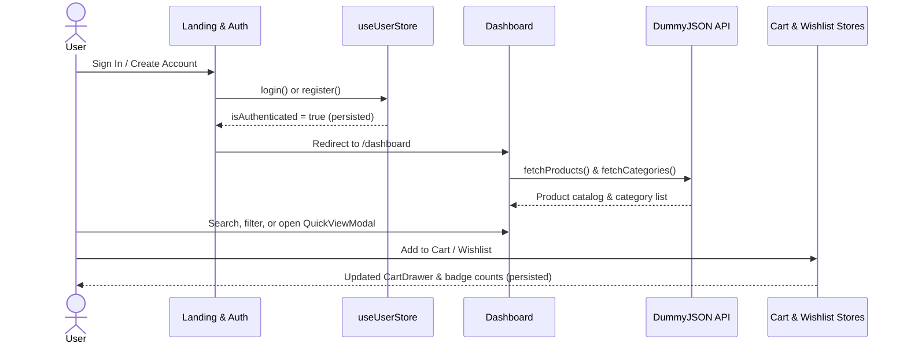

# Vendora


A modern e-commerce storefront built with Next.js (App Router), React, TypeScript, Tailwind CSS, and Zustand — featuring live product discovery, category filtering, slide-over cart and wishlist drawers, session-based authentication, and order tracking.
---

## Features

| Module | Capabilities | Key Components |
| :--- | :--- | :--- |
| **Product Catalog** | Browse featured items, view product cards with pricing & discounts, inspect details via quick-view modal, and track up to 10 recently viewed products | `FeaturedProducts`, `ProductCard`, `QuickViewModal`, `RecentlyViewed` |
| **Search & Filtering** | Instant search autocomplete dropdown plus category, price-range, rating, and stock filters | `SearchAutocomplete`, `ProductFilters`, `Categories` |
| **Shopping Cart** | Slide-over cart drawer with quantity controls, automatic discount pricing, subtotal calculation, and persistent storage | `CartDrawer`, `useCartStore` |
| **Wishlist** | Save and manage favorite products in a dedicated slide-over drawer with persisted badge counters | `WishlistDrawer`, `useWishlistStore` |
| **Authentication & Profile** | Sign in / create account modal and dedicated auth routes guarding dashboard pages, plus profile management | `AuthModal`, `useUserStore`, `ProfilePage` |
| **Order Tracking** | View order history and shipment statuses (`processing`, `shipped`, `delivered`) | `OrdersPage`, `useUserStore` |
| **UI & Hydration Safety** | Mobile-first responsive navigation, skeleton loading placeholders, and SSR-safe client hydration guards | `Navbar`, `SkeletonLoader`, `ClientOnly`, `useHydration` |

---

## Tech Stack

| Category | Technology | Version | Role |
| :--- | :--- | :--- | :--- |
| **Framework** | Next.js (App Router + Turbopack) | `^16.1.6` | Routing, SSR/CSR rendering, and image optimization |
| **UI Library** | React & React DOM | `19.1.0` | Component-driven user interface |
| **Language** | TypeScript | `^5` | End-to-end static typing across components, stores, and APIs |
| **Styling** | Tailwind CSS + `clsx` + `tailwind-merge` | `^4` | Utility-first responsive design system |
| **State Management** | Zustand (`persist` middleware) | `^5.0.8` | Client state & `localStorage` persistence |
| **Forms & Validation** | React Hook Form + Zod + Resolvers | `^7.62.0` / `^4.1.8` | Form state management and schema validation |
| **Icons & Utilities** | Lucide React & `uuid` | `^0.544.0` / `^13.0.0` | Vector iconography and unique identifier generation |
| **Catalog API** | DummyJSON Products API | REST | Product catalog, search, and category feeds (`dummyjson.com`) |
| **Database** | MySQL | `8.0` | Relational database target for persistent backend data |
| **Tooling** | ESLint + `eslint-config-next` | `^9` | Code quality and Next.js lint rules |

---

## Architecture

### System & Data Flow



### Source Code Distribution



<details>
<summary><b>Interactive Flow: Authentication & Shopping Journey</b></summary>



</details>

---

## Application Routes

| Route | Access | Description | Source |
| :--- | :--- | :--- | :--- |
| `/` | Public | Storefront landing page and authentication entry | `src/app/page.tsx` |
| `/login` | Public | Sign-in screen (redirects authenticated users to `/dashboard`) | `src/app/(auth)/login/page.tsx` |
| `/register` | Public | Account registration screen | `src/app/(auth)/register/page.tsx` |
| `/dashboard` | Authenticated | Main storefront view (`Hero`, `Categories`, `FeaturedProducts`, `RecentlyViewed`, `Newsletter`) | `src/app/(dashboard)/dashboard/page.tsx` |
| `/products` | Authenticated | Full product catalog browser | `src/app/(dashboard)/products/page.tsx` |
| `/categories` | Authenticated | Category directory view | `src/app/(dashboard)/categories/page.tsx` |
| `/orders` | Authenticated | Order history and delivery status tracker | `src/app/(dashboard)/orders/page.tsx` |
| `/profile` | Authenticated | User account summary and profile management | `src/app/(dashboard)/profile/page.tsx` |

<details>
<summary><b>State Stores & Persistence Reference (Zustand)</b></summary>

| Store | Storage Key | Managed State | Primary Actions |
| :--- | :--- | :--- | :--- |
| `useCartStore` (`src/store/cartStore.ts`) | `cart-storage` | `items: CartItem[]` | `addItem`, `removeItem`, `updateQuantity`, `clearCart`, `getTotalItems`, `getTotalPrice` |
| `useWishlistStore` (`src/store/wishlistStore.ts`) | `wishlist-storage` | `items: Product[]` | `addItem`, `removeItem`, `isInWishlist`, `clearWishlist`, `getItemCount` |
| `useRecentlyViewedStore` (`src/store/recentlyViewedStore.ts`) | `recently-viewed-storage` | `items: Product[]` (max `10`) | `addItem`, `removeItem`, `clearRecentlyViewed`, `getItemCount` |
| `useUserStore` (`src/store/userStore.ts`) | `user-storage` | `user`, `orders`, `isAuthenticated` | `login`, `register`, `logout`, `addOrder`, `updateProfile` |

</details>

<details>
<summary><b>Catalog API Functions (<code>src/lib/api.ts</code>)</b></summary>

| Function | Endpoint (`https://dummyjson.com/products`) | Purpose |
| :--- | :--- | :--- |
| `fetchProducts(limit, skip)` | `GET ?limit={limit}&skip={skip}` | Fetch paginated product list (default `limit = 20`) |
| `fetchProductById(id)` | `GET /{id}` | Fetch single product details |
| `fetchProductsByCategory(category)` | `GET /category/{category}` | Filter products by category slug |
| `searchProducts(query)` | `GET /search?q={query}` | Full-text product search |
| `fetchCategories()` | `GET /categories` | Retrieve normalized category names |

</details>

---

## Getting Started

### Prerequisites

- **Node.js** `20+` (recommended for Next.js 16 & React 19)
- **npm** (included with Node.js)

### Installation

```bash
git clone https://github.com/madhanmohanreddyperam06/Vendora.git
cd Vendora
npm install
npm run dev
```

Open [http://localhost:3000](http://localhost:3000) in your browser to view the storefront.

### Available Scripts

| Command | Underlying Script | Description |
| :--- | :--- | :--- |
| `npm run dev` | `next dev --turbopack` | Start the local development server with Turbopack |
| `npm run build` | `next build --turbopack` | Create an optimized production build |
| `npm run start` | `next start` | Serve the production build |
| `npm run lint` | `eslint` | Run ESLint checks across the codebase |

> [!NOTE]
> Remote product images are configured in `next.config.ts` for `cdn.dummyjson.com` and `i.dummyjson.com`. Ensure internet access is available when running locally so catalog items and thumbnails load properly.

---

## Project Structure

<details>
<summary><b>Expand Directory Tree (<code>src/</code> &amp; Config)</b></summary>

```text
Vendora/
├── next.config.ts                # Next.js config & DummyJSON image remotePatterns
├── package.json                  # Dependencies & npm scripts
├── tsconfig.json                 # TypeScript configuration
├── eslint.config.mjs             # ESLint rules
├── postcss.config.mjs            # PostCSS / Tailwind CSS v4 setup
├── LICENSE                       # MIT License
└── src/
    ├── app/                      # Next.js App Router pages & layouts
    │   ├── (auth)/               # Auth layout, /login, /register
    │   ├── (dashboard)/          # Protected layout, /dashboard, /products, /categories, /orders, /profile
    │   ├── globals.css           # Global styles
    │   ├── layout.tsx            # Root layout
    │   └── page.tsx              # Public landing page (/)
    ├── components/               # 17 reusable storefront UI components, modals & drawers
    ├── hooks/                    # useHydration, useLoadingState
    ├── lib/                      # api.ts (DummyJSON client) & utils.ts
    ├── store/                    # Zustand stores (cart, wishlist, recentlyViewed, user)
    └── types/                    # Shared TypeScript interfaces (Product, CartItem, Order, User)
```

</details>

---

## Acknowledgments

| Resource | Purpose |
| :--- | :--- |
| [Next.js](https://nextjs.org/) | React framework & App Router |
| [Tailwind CSS](https://tailwindcss.com/) | Utility-first styling framework |
| [Lucide React](https://lucide.dev/) | UI icon library |
| [DummyJSON](https://dummyjson.com/) | Product catalog & category REST API |

## License

Licensed under the [MIT License](./LICENSE).

## Contact Information

### Madhan Mohan Reddy

- **Email**: <madhanmohanreddyperam06@gmail.com>
- **Mobile**: +91 9110395993

---
<div align="center">
© 2025 Vendora. All rights reserved.
</div>

